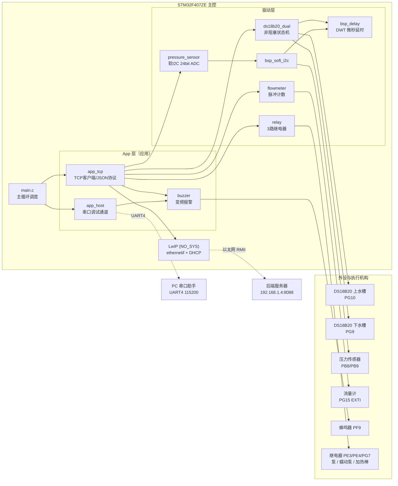
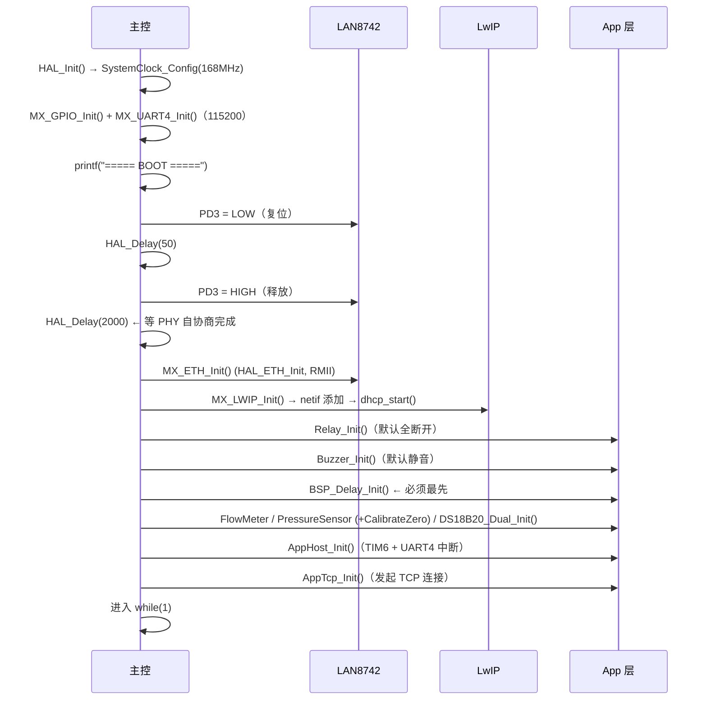

# 智能饮水机控制系统（Water Dispenser Controller）

> 基于 **STM32F407ZE + LwIP 裸机 TCP 客户端** 的智能饮水机主控固件。
> 采集双路水槽温度、管路压力、流量，通过以太网以 **JSON 协议** 主动上报后端服务器，
> 并接收后端的 **动作命令**（上水泵 / 循环泵 / 加热棒）与 **温度报警阈值配置**。


-orange)

-lightgrey)

---

## 一、这个项目解决什么问题

饮水机需要把「水槽温度、管路压力、累计流量」这些运行数据实时送到上位机/云端，同时接受远程对水泵和加热棒的开关控制。

本固件承担设备侧全部工作：

| 能力 | 实现方式 |
|------|----------|
| 双路水槽温度采集 | 2 × DS18B20，**非阻塞状态机**，不阻塞网络 |
| 管路压力采集 | P31 系列压力传感器，**软件 I2C**（PB8/PB9）读 24 位 ADC |
| 流量计量 | 霍尔流量计，EXTI 下降沿脉冲计数 → 瞬时 + 累计流量 |
| 执行机构控制 | 3 路继电器：上水泵(385)、循环泵(蠕动)、加热棒 |
| 温度超限报警 | 蜂鸣器 + **变频率报警**（越限越多响得越快） |
| 网络通讯 | LwIP 裸机 raw API，**TCP 客户端**主动连后端，JSON 收发，断线自动重连 |
| 本地调试 | UART4 串口命令通道（ASCII 指令，可完全离线操作设备） |

**设计取舍**：全程**不使用 RTOS**（`NO_SYS=1`），降低复杂度与内存占用；代价是所有长耗时外设操作（DS18B20 的 750ms 转换、软 I2C 时序）必须改写为非阻塞或分段执行——这也是本项目最核心的工程量所在。

---

## 二、系统架构



### 数据流（一句话版）

```
传感器 → 驱动层缓存 → app_tcp 组装 JSON → LwIP TCP → 后端
后端 JSON 命令 → app_tcp 解析 → relay / buzzer → 执行机构
                      ↓
                 回 ack 报文
```

---

## 三、目录结构

```
none_Lower/
├── README.md                    ← 本文件（项目总览）
├── .gitignore                   ← （待补充，见「已知问题」）
└── test/                        ← Keil MDK-ARM 工程根目录
    ├── eth.ioc                  ← STM32CubeMX 工程文件
    ├── .mxproject               ← CubeMX 元数据
    ├── App/                     ← ★ 应用与驱动层（本项目核心，共 22 个文件）
    │   ├── README.md            ← App 层引脚表与接入说明（详见该文件）
    │   ├── app_tcp.c/.h         ← TCP 客户端 + JSON 协议（约 900 行，最复杂）
    │   ├── app_host.c/.h        ← 串口模拟上位机（TIM6 定时采集 + UART4 命令）
    │   ├── ds18b20_dual.c/.h    ← 双路 DS18B20 独立引脚版（★当前在用）
    │   ├── ds18b20_shared.c/.h  ← 双路 DS18B20 共享引脚版（备选，未编入工程）
    │   ├── pressure_sensor.c/.h ← 压力传感器
    │   ├── flowmeter.c/.h       ← 流量计
    │   ├── relay.c/.h           ← 3 路继电器
    │   ├── buzzer.c/.h          ← 蜂鸣器 + TIM7 变频报警
    │   ├── bsp_soft_i2c.c/.h    ← 软件模拟 I2C
    │   └── bsp_delay.c/.h       ← DWT 微秒级延时
    ├── Core/                    ← CubeMX 生成（用户代码在 USER CODE 段内）
    │   ├── Src/main.c           ← 启动序列 + 主循环
    │   ├── Src/gpio.c           ← GPIO 初始化
    │   ├── Src/usart.c          ← UART4 = 115200 8N1（printf 重定向）
    │   ├── Src/stm32f4xx_it.c   ← 中断服务（含 EXTI15_10 → 流量计）
    │   └── Inc/main.h
    ├── Drivers/                 ← ST HAL 库 + CMSIS（勿手动修改）
    │   └── BSP/Components/lan8742/  ← PHY 驱动
    ├── LWIP/                    ← LwIP 协议栈
    │   ├── App/lwip.c/.h        ← netif 初始化、DHCP 定时器手动驱动
    │   └── Target/lwipopts.h    ← ★ 协议栈裁剪配置（LWIP_DHCP=1 等）
    ├── Middlewares/Third_Party/ ← LwIP 源码
    └── MDK-ARM/
        ├── eth.uvprojx          ← ★ Keil 工程文件，双击打开
        ├── startup_stm32f407xx.s
        └── eth/                 ← 编译输出（.o/.d/.crf，应被 .gitignore 排除）
```

---

## 四、硬件清单

| 器件 | 型号 / 规格 | 说明 |
|------|-------------|------|
| 主控 MCU | **STM32F407ZE**（LQFP144，512KB Flash / 192KB RAM） | Keil 工程 `<Device>` 字段确认 |
| 外部晶振 | HSE 8 MHz | PLL: M=8, N=336, P=2 → **SYSCLK 168 MHz** |
| 以太网 PHY | **LAN8742**（RMII 接口） | 驱动在 `Drivers/BSP/Components/lan8742` |
| MAC 地址 | `00:80:E1:00:00:00` | 定义于 `main.c`，多设备同网需修改 |
| 温度传感器 | 2 × **DS18B20**（1-Wire，12bit） | 上水槽 PG10 / 下水槽 PG9 |
| 压力传感器 | **P31 系列**（24bit ADC，I2C 输出） | 地址 0xB0/0xB1 |
| 流量计 | 霍尔脉冲式（YF 系列类） | 系数 `450 pulse/L`（**需按实物核对**） |
| 继电器模块 | 3 路，**高电平吸合** | 385泵 / 蠕动泵 / 加热棒 |
| 蜂鸣器 | 有源蜂鸣器 + 三极管驱动 | **高电平响** |

---

## 五、引脚分配

> 以下以**代码实际定义**为准（`relay.h` / `buzzer.h` / `App/README.md` 交叉核对）。

| 功能 | 引脚 | 模式 | 备注 |
|------|------|------|------|
| 压力传感器 SCL | **PB8** | 开漏 + 上拉，软件 I2C | FT 引脚，5V 容忍 |
| 压力传感器 SDA | **PB9** | 开漏 + 上拉，软件 I2C | FT 引脚，5V 容忍 |
| DS18B20 上水槽 | **PG10** | 开漏 + 上拉，1-Wire | 独立版独占一根 |
| DS18B20 下水槽 | **PG9** | 开漏 + 上拉，1-Wire | 独立版独占一根 |
| 流量计脉冲输入 | **PG15** | EXTI 下降沿 | 在 `FlowMeter_Init()` 内配置 |
| 385 抽水泵（电机） | **PE3** | 推挽输出 | RELAY1 |
| 蠕动泵 | **PE4** | 推挽输出 | RELAY2 |
| 加热棒 | **PG7** | 推挽输出 | RELAY3 |
| 蜂鸣器 | **PF9** | 推挽输出 | 高电平响 |
| 调试串口 TX/RX | **PC10 / PC11** | AF8 → UART4 | 115200 8N1 |
| 以太网 PHY 复位 | **PD3** | 推挽输出 | 低电平复位，上电时序见下 |
| 以太网 MDC/MDIO/RMII | 标准 AF11 | — | CubeMX 生成 |

---

## 六、软件流程

### 6.1 启动序列（`main()`）



### 6.2 主循环（`while(1)`，无阻塞）

| 顺序 | 调用 | 频率 / 作用 |
|------|------|-------------|
| 1 | `MX_LWIP_Process()` | 每轮。协议栈轮询 + **手动驱动 DHCP 粗/细定时器**（裸机模式必须） |
| 2 | 首次链路 UP 时发 ARP | 仅一次，探测网关 `192.168.1.11` |
| 3 | 每 2s 打印 `alive...` | 打印 netif 状态、IP、PHY BSR 寄存器，用于**链路诊断** |
| 4 | `DS18B20_Dual_Process()` | 每轮推进温度状态机（每 ~750ms 后台刷新一路缓存） |
| 5 | `AppHost_Process()` | 串口命令处理（调试/回退通道） |
| 6 | `AppTcp_Process()` | 断线重连驱动（3s 间隔） |

**关键点**：主循环内**没有任何 `HAL_Delay` / 阻塞等待**。DS18B20 的 750ms 转换、软 I2C 的位操作全部拆成状态机或微秒级延时，保证 TCP 无采集延迟。

---

## 七、快速开始

### 步骤 1：准备环境

| 项目 | 要求 |
|------|------|
| IDE | Keil MDK-ARM v5（工程含 `.uvprojx`） |
| 器件包 | `Keil.STM32F4xx_DFP`（含 STM32F407ZE） |
| 编译器 | ARM Compiler 5 或 6（工程默认配置） |
| 调试器 | ST-Link / J-Link（SWD） |
| 上位机 | PC 端运行 TCP **服务端**程序，监听 8088 |

### 步骤 2：改两个必改参数

**① 后端服务器 IP** —— `App/app_tcp.h`：

```c
#define APP_TCP_SERVER_IP_A        192
#define APP_TCP_SERVER_IP_B        168
#define APP_TCP_SERVER_IP_C        1
#define APP_TCP_SERVER_IP_D        4      // ← 改成你 PC 的实际 IP
#define APP_TCP_PORT               8088   // ← 后端监听端口
#define APP_TCP_DEVICE_ID          "WC-001"  // ← 多设备部署时必须唯一
```

**② MAC 地址** —— `Core/Src/main.c`（同网段多台设备必须不同）：

```c
uint8_t ETH_MAC_ADDR[6] = {0x00, 0x80, 0xE1, 0x00, 0x00, 0x00};
```

### 步骤 3：编译烧录

1. 打开 `test/MDK-ARM/eth.uvprojx`
2. `Project → Build Target`（F7）→ 应 0 error
3. `Flash → Download`（F8）
4. 复位运行，串口助手（**115200 8N1**）应看到：

```
===== BOOT =====
PD3 reset...
>>> HAL_ETH_Init OK!
Calling MX_LWIP_Init...
MAC: 00:80:E1:00:00:00
netif up=1, link=1
===== DHCP started, waiting for router to assign IP =====
Relay initialized (all OFF).
Sensors initialized.
TCP client connecting to 192.168.1.4:8088 ...
alive... up=1 link=1 ip=192.168.1.123 phy_bsr=0x0000786D
```

### 步骤 4：验证连通

- 看到 `alive... ip=192.168.x.x`（非 `0.0.0.0`）说明 **DHCP 成功**
- 后端服务端应收到首次 `{"type":"hello",...}` 报文
- 之后每 1s 收到一包 `{"type":"data",...}` 遥测

### 步骤 5：下发命令验证

用任意 TCP 工具（如 `netcat` 或自写 Python 脚本）向后端连接对应的客户端发送：

```json
{"type":"command","deviceId":"WC-001","commandId":"cmd-001","cmd":"motor","value":"on"}
```

设备应回复 `ack` 且 PE3 继电器吸合。

---

## 八、网络配置

| 项目 | 值 | 位置 |
|------|-----|------|
| IP 获取方式 | **DHCP（动态）** | `lwip.c` 中 `IP_ADDRESS[]` 全 0，`LWIP_DHCP=1` |
| 静态 IP 兜底 | 若 DHCP 失败，地址保持 `0.0.0.0` | 需路由器正常分配 |
| 子网掩码 / 网关 | 由 DHCP 下发 | — |
| PHY 接口 | **RMII** | `MX_ETH_Init()` 中 `ETH_MEDIA_INTERFACE_RMII` |
| 收包模式 | 中断模式 `HAL_ETH_Start_IT` | `main.c` |
| 协议栈模式 | `NO_SYS = 1`（Raw API） | `lwipopts.h` |
| 链路断开处理 | 链路 DOWN 时 `dhcp_stop`；恢复后 `dhcp_start` 重新申请 | `lwip.c` 链路回调 |

> ⚠️ **裸机 LwIP 的坑**：`NO_SYS=1` 下 DHCP 的 `dhcp_fine_tmr` / `dhcp_coarse_tmr` 不会自动挂载到 `sys_timeout`，必须由主循环按 100ms / 500ms 手动调用，否则**永远拿不到 IP**。本工程已在 `MX_LWIP_Process()` 中实现，修改时不要删。

---

## 九、通讯协议（JSON over TCP）

**连接方向**：**STM32 是客户端**，主动连接 `APP_TCP_SERVER_IP:8088`；PC/服务器是服务端。
**报文格式**：每包一行 JSON，以 `\r\n` 结尾。**所有上行报文都带 `deviceId`**。
**重连策略**：连接失败或断线后，每 **3s** 重试一次；握手（hello）发出后 3s 未收到 `hello_ack` 则重发 hello。

### 9.1 握手

**设备 → 后端**

```json
{"type":"hello","deviceId":"WC-001","device":"water_dispenser","firmware":"1.0.0","ip":"192.168.1.123","proto":"json"}
```

**后端 → 设备**

```json
{"type":"hello_ack","deviceId":"WC-001","result":"ok","reportIntervalMs":2000,"heartbeatIntervalMs":5000}
```

| 字段 | 作用 |
|------|------|
| `reportIntervalMs` | 覆盖遥测上报周期（默认 1000ms） |
| `heartbeatIntervalMs` | 心跳周期（默认 5000ms，当前由 `data` 上报充当心跳） |

> **只有收到 `hello_ack` 之后才开始周期上报**，保证后端已就绪。

### 9.2 遥测上报

**周期数据（`data`）**

```json
{"type":"data","deviceId":"WC-001","seq":1,"uptime_s":10,"temp_up":25.5,"temp_dn":24.8,"pressure_kpa":101.3,"flow_rate":0.0,"flow_volume":0.0,"motor":0,"pump":0,"heater":0}
```

| 字段 | 单位 | 说明 |
|------|------|------|
| `seq` | — | 自增上报序号，用于丢包判断 |
| `uptime_s` | s | 上电累计秒数 |
| `temp_up` | ℃ | 上水槽温度（读状态机缓存，非阻塞） |
| `temp_dn` | ℃ | 下水槽温度 |
| `pressure_kpa` | kPa | 管路压力 |
| `flow_rate` | L/min | 瞬时流量 |
| `flow_volume` | L | 累计流量 |
| `motor` / `pump` / `heater` | 0/1 | 三路执行机构当前状态 |

**状态上报（`status`）** —— 命令执行后或状态变化时触发：

```json
{"type":"status","deviceId":"WC-001","motor":0,"pump":0,"heater":0}
```

### 9.3 动作命令

**后端 → 设备**

```json
{"type":"command","deviceId":"WC-001","commandId":"cmd-001","cmd":"motor","value":"on"}
```

**设备 → 后端（应答）**

```json
{"type":"ack","deviceId":"WC-001","commandId":"cmd-001","cmd":"motor","value":"on","result":"ok"}
```

| `cmd` | 含义 | 对应继电器 |
|-------|------|-----------|
| `motor` | 上水泵（385 泵） | PE3 / RELAY1 |
| `pump` | 循环泵（蠕动泵） | PE4 / RELAY2 |
| `heater` | 加热棒 | PG7 / RELAY3 |
| `all` | 三路统一开关 | — |

`value` 取值：`on` / `off`。`result` 取值：`ok` / 失败原因。

### 9.4 温度报警配置

**后端 → 设备**

```json
{"type":"config","deviceId":"WC-001","commandId":"config-001","temperatureAlarm":{"sensorKey":"temperature_2","threshold":40.5}}
```

**设备 → 后端**

```json
{"type":"config_ack","deviceId":"WC-001","commandId":"config-001","result":"ok"}
```

| `sensorKey` | 对应传感器 |
|-------------|-----------|
| `temperature_1` | 上水槽（`temp_up`） |
| `temperature_2` | 下水槽（`temp_dn`） |

`threshold` 为 float，支持小数（解析器为手写、零依赖、不用 `%f`，兼容 microlib）。

### 9.5 报警蜂鸣策略

越限后蜂鸣频率随**超出幅度**变化（`AppTcp_AlarmBeepPeriod()`）：

| 超出阈值幅度 | 蜂鸣周期 | 效果 |
|--------------|----------|------|
| ≤ 0（未越限） | 0 | 静音 |
| < 2 ℃ | 1000 ms | 1 声/秒 |
| 2 ~ 5 ℃ | 500 ms | 2 声/秒 |
| 5 ~ 10 ℃ | 250 ms | 4 声/秒 |
| ≥ 10 ℃ | 120 ms | ~8 声/秒，急促 |
| 温度读取失败 | 0 | 静音（避免误报） |

---

## 十、串口调试命令（UART4 / PC10-PC11 / 115200）

即使没有网络，也能用串口完全手动操作设备。命令**换行结束、大小写不敏感**。

| 命令 | 别名 | 参数 | 作用 |
|------|------|------|------|
| `MOTOR ON\|OFF` | `M1` / `M` | on/off | 上水泵 |
| `PUMP ON\|OFF` | `M2` / `P` | on/off | 蠕动泵 |
| `HEATER ON\|OFF` | `M3` | on/off | 加热棒 |
| `ALL ON\|OFF` | — | on/off | 三路统一开关 |
| `STATUS` | `ST` | — | 打印当前继电器状态 |
| `DATA` | `READ` | — | 立即采集并上报一次 |
| `CLR` | `RESET` | — | 流量计累计值清零 |
| `ISCAN` | — | — | 软 I2C 总线扫描（找压力传感器地址） |
| `PRAW` | — | — | 打印压力传感器原始 24bit ADC 值 |
| `PZERO` | — | — | 压力传感器零点标定 |
| `HELP` | `?` | — | 打印帮助 |

> 采集周期由 `AppHost_Process()` 中 `HOST_COLLECT_INTERVAL_S`（默认 2s）控制，采集动作在主循环执行（**不在中断里**做阻塞的 1-Wire/I2C 读写）。

---

## 十一、实现要点（为什么这么写）

### 11.1 DS18B20 为什么必须非阻塞

DS18B20 一次 12bit 转换需要 **750ms**。若在主循环里 `HAL_Delay(750)` 等待，会造成：
- LwIP 无法及时轮询，TCP 断包 / 超时
- 串口命令延迟 750ms 以上

因此 `ds18b20_dual.c` 改写为**状态机**：每次 `DS18B20_Dual_Process()` 推进一步（发转换 → 等待 → 读回 → 换下一路），750ms 期间主循环照常运行。消费方只读缓存：

```c
float   t = DS18B20_Dual_GetTemp(DS18B20_DUAL_UPPER);   // 读缓存，立即返回
uint8_t ok = DS18B20_Dual_GetStatus(DS18B20_DUAL_UPPER); // 数据是否有效
```

**不要**再调用阻塞版 `ReadTemp()`。

### 11.2 为什么用软件 I2C

压力传感器是 5V 供电、开漏 I2C 总线；硬件 I2C 在 5V 上拉下存在电平与仲裁风险，且 F407 硬件 I2C 在有中断干扰时易挂死。软件 I2C + DWT 微秒延时最稳，也便于 **ISCAN / PRAW 现场诊断**。

### 11.3 为什么手写 JSON 解析

STM32 + microlib 环境下：
- 引入 cJSON 增加约 10KB Flash，且浮点格式化需重配 microlib
- 协议 schema 完全固定

所以 `app_tcp.c` 内实现了 4 个极简函数（`JsonGetString` / `JsonGetInt` / `JsonGetFloat` / `JsonSkipWs`）+ 自写 `AppTcp_FmtFloat`（不用 `%f`），**零依赖、可控、可调试**。

### 11.4 温度驱动两个版本二选一

| 版本 | 接线 | 机制 | 状态 |
|------|------|------|------|
| `ds18b20_dual` | 两路各占一根 GPIO（PG10/PG9） | Skip ROM | ★ **当前在用**（已编入 Keil 工程） |
| `ds18b20_shared` | 两路共用一根 GPIO | ROM 搜索 + Match ROM | 备选，**未编入工程** |

⚠️ **不要同时把两个 .c 加入 Keil**，会符号重复。

---

## 十二、已知问题与注意事项

### 12.1 代码与文档的已知不一致（以代码为准）

| 项 | `App/README.md` 描述 | 代码实际 | 处理建议 |
|----|---------------------|----------|----------|
| 加热棒引脚 | PG6 | **PG7**（`relay.h`） | 以 PG7 为准，`App/README.md` 待更新 |
| 继电器吸合电平 | 低电平吸合 | **高电平吸合**（`relay.h` 已改为 `GPIO_PIN_SET`，注释写明"本板实测"） | 以代码为准 |
| 遥测周期默认值 | — | `app_tcp.c` 注释写"默认 2s"，实际初值 `1000ms` | 注释待修正 |

### 12.2 仓库卫生

- **缺 `.gitignore`**：当前 729 个受版本控制文件中，**347 个是 `.o` / `.d` / `.crf` 编译产物**（`MDK-ARM/eth/` 目录）。建议补 `.gitignore` 并清理索引。
- `.uvguix.*`（Keil 用户界面布局，约 170KB/个）也是个人环境文件，建议一并忽略。

### 12.3 硬件相关待核对项

| 项 | 当前值 | 需确认 |
|----|--------|--------|
| 压力传感器量程 | `PRESSURE_FULL_KPA = 1600.0`（1.6MPa） | 按 P31/P32/P33 实物手册 |
| 流量计系数 | `FLOW_PULSES_PER_LITER = 450.0` | 按流量计型号 |
| 继电器有效电平 | 高电平吸合 | 已按实测调整，换板需复核 |
| 蜂鸣器有效电平 | 高电平响 | 换驱动电路需复核 |
| 5V 电平安全 | PB8/PB9/PG9/PG10/PG15 均为 FT 引脚 | 确认模块上拉 ≤5.5V |

### 12.4 运行注意事项

1. **PG15 的 EXTI 已在 `FlowMeter_Init()` 中手动配置**——不要在 CubeMX 里再配 PG15 为 EXTI，否则 `EXTI15_10_IRQHandler` 重复定义。
2. **CubeMX 重新生成代码**：`App/` 目录不在 `Core/` 下，**不会被覆盖**；但 `main.c` 的初始化调用写在 `USER CODE` 段内，重新生成前确认段落完整。
3. **PD3 复位延时不能省**：`HAL_Delay(2000)` 是等 PHY 自协商完成，改成 50ms 会导致 `HAL_ETH_Init` 失败或链路不稳定。
4. **设备 ID 唯一性**：`APP_TCP_DEVICE_ID` 默认 `"WC-001"`，多设备部署必须逐个修改，否则后端会串号。

---

## 十三、后续可开展的工作

- [ ] 补充 `.gitignore`，从索引移除 347 个编译产物
- [ ] 同步 `App/README.md` 中加热棒引脚（PG6 → PG7）与继电器电平描述
- [ ] 增加静态 IP 兜底：DHCP 超时后回落到固定地址，避免路由器异常时设备失联
- [ ] 遥测报文增加传感器有效性标志（当前温度读取失败时仍上报 0.0）
- [ ] 加热棒增加**软件超温硬保护**（除报警外，超过安全阈值强制断开继电器）
- [ ] 后端下发配置增加掉电保存（当前阈值断电即丢失）

---

## 十四、相关文档

| 文档 | 内容 |
|------|------|
| [`test/App/README.md`](none_Lower/test/App/README.md) | App 层完整引脚表、模块接入 Keil 步骤、各驱动参数核对清单 |
| `test/LWIP/Target/lwipopts.h` | LwIP 裁剪配置（`LWIP_DHCP=1`、`NO_SYS=1` 等） |
| `test/eth.ioc` | CubeMX 图形化配置（时钟树、引脚、外设） |

---

**仓库**：<https://github.com/mlik001/Water>
**固件版本**：1.0.0（`app_tcp.c` hello 报文中的 `firmware` 字段）
**平台**：STM32F407ZE / HAL F4 / LwIP 2.x (NO_SYS) / Keil MDK-ARM
